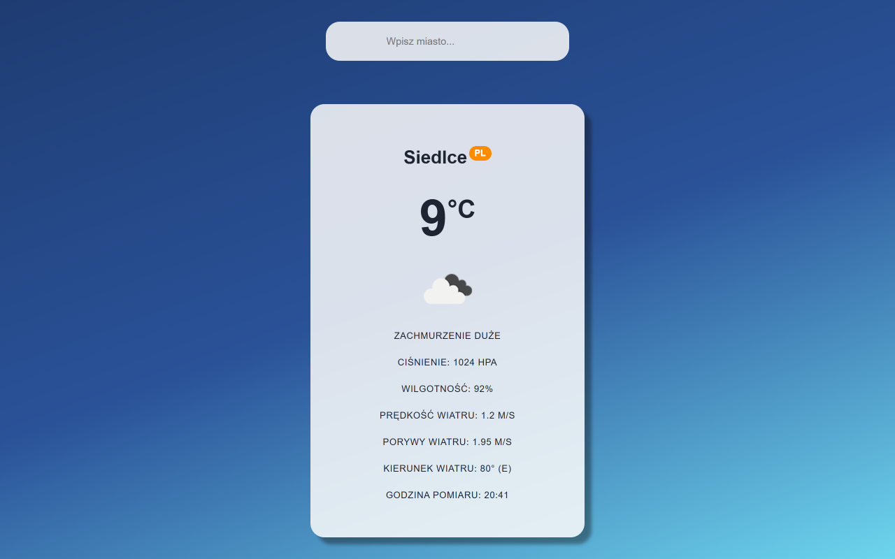
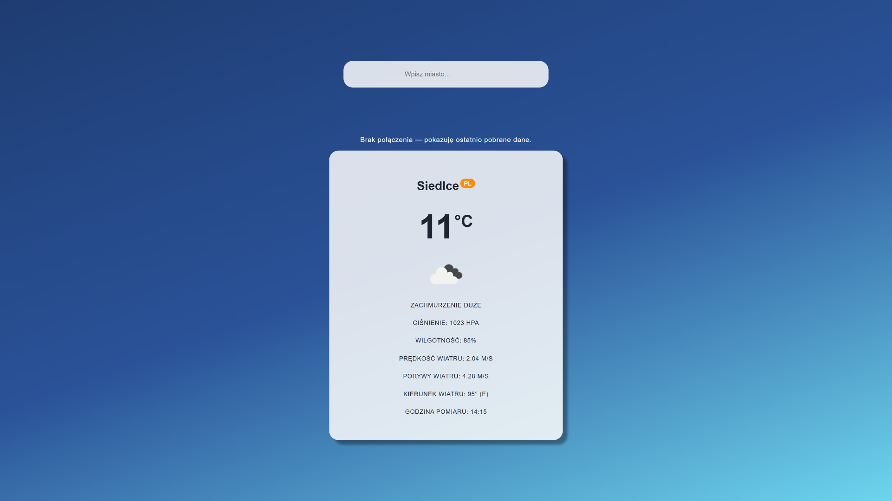

# Laboratorium 3 – Weather App PWA

## Opis

Aplikacja pogodowa wykonana w React z wykorzystaniem Vite i OpenWeatherMap API.

Aplikacja umożliwia wyszukiwanie pogody dla wybranego miasta i wyświetlanie:
- nazwy miasta oraz kraju,
- temperatury,
- ikony i opisu pogody,
- ciśnienia atmosferycznego,
- wilgotności,
- prędkości oraz porywów wiatru,
- kierunku wiatru w stopniach i jako strony świata,
- godziny pomiaru.

Aplikacja wykorzystuje PWA i Workbox do zapisywania wcześniej pobranych danych w pamięci cache, dzięki czemu może działać również bez połączenia z internetem.

## Technologie

- React
- Vite
- JavaScript
- OpenWeatherMap API
- vite-plugin-pwa
- Workbox

## Uruchomienie

Wymagany jest Node.js oraz prawidłowy klucz OpenWeatherMap API wpisany w `src/api/fetchWeather.js`.

Instalacja zależności:

```bash
npm install
```

Uruchomienie w trybie deweloperskim:

```bash
npm run dev
```

Zbudowanie wersji produkcyjnej:

```bash
npm run build
```

Uruchomienie podglądu wersji produkcyjnej:

```bash
npm run preview
```

## Działanie offline

Service worker wykorzystuje strategię NetworkFirst do obsługi zapytań pogodowych oraz CacheFirst do obsługi ikon.

Wcześniej pobrane dane pogodowe mogą zostać wyświetlone bez dostępu do internetu.

## Zrzuty ekranu

### Wyświetlanie pogody



### Praca offline

