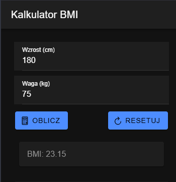

# Laboratorium 04 – Ionic React

## Opis

W ramach laboratorium wykonano aplikację w Ionic React zawierającą dwa kalkulatory:

- **Kalkulator BMI** – oblicza wskaźnik BMI na podstawie podanego wzrostu i wagi. Wynik wyświetlany jest z dokładnością do dwóch miejsc po przecinku. Przycisk Resetuj pozwala wyczyścić pola i wynik.
- **Kalkulator matematyczny** – umożliwia wykonywanie podstawowych działań: dodawania, odejmowania, mnożenia i dzielenia. Obsługuje również liczby dziesiętne i dzielenie przez zero.

W zadaniu 3 wykonano także funkcje dodatkowe: zmianę znaku liczby (±), procenty (%), usuwanie ostatniej cyfry (⌫), liczenie łańcuchowe oraz obsługę klawiatury.

## Uruchomienie

Wymagane jest zainstalowanie Node.js oraz Ionic CLI.

Po pobraniu projektu należy przejść do folderu `lab_04` i wykonać:

1. Instalacja zależności: `npm install`
2. Uruchomienie aplikacji: `ionic serve`

Aplikacja będzie dostępna pod adresem http://localhost:8100.

## Zrzuty ekranu

### Kalkulator BMI

Przykładowe obliczenie BMI dla wzrostu 180 cm i wagi 75 kg.

### Kalkulator matematyczny

Przykładowy wynik działania 9 − 4 = 5.

